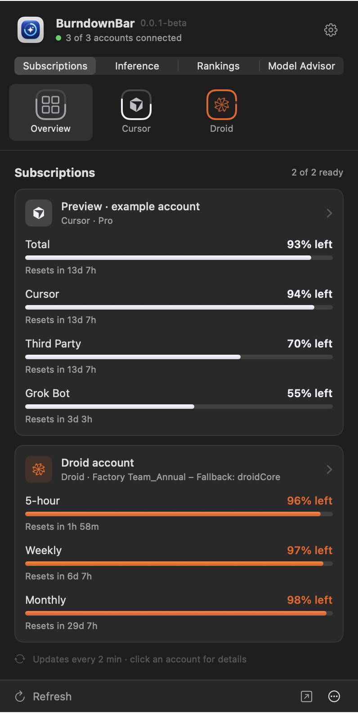
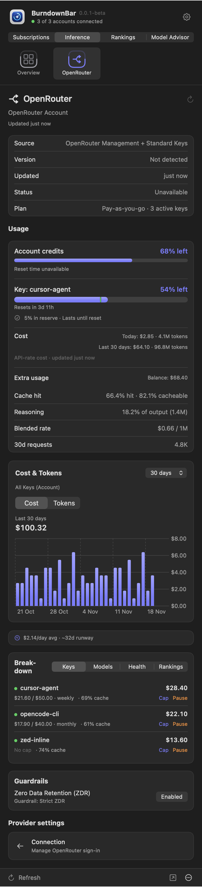
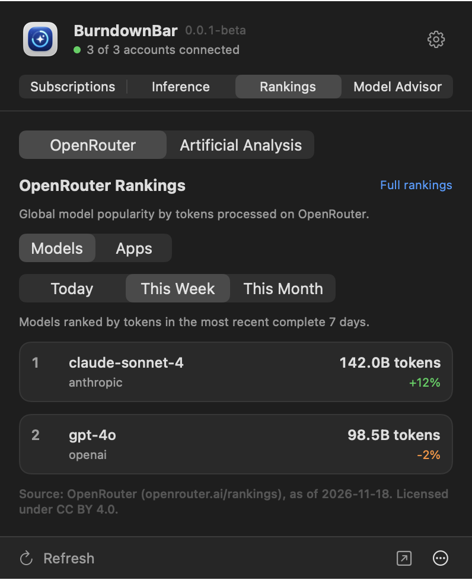
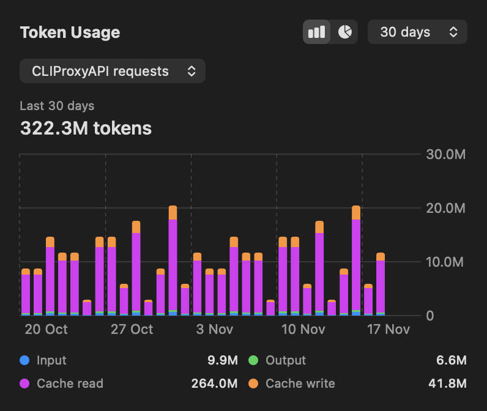
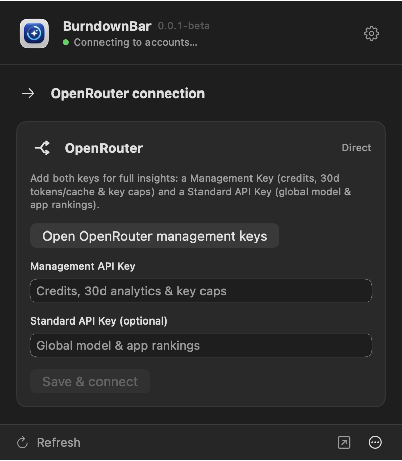
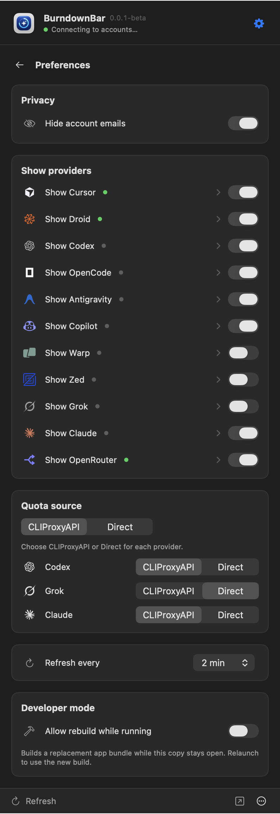
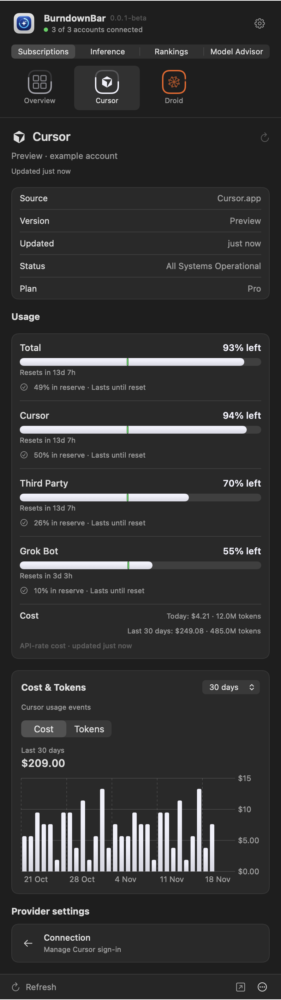

<div align="center">
  
  <h1>BurndownBar</h1>
  <p>May you not Burndown your AI tokens</p>
  <p>
    
    
    
  </p>
</div>

A lightweight, native macOS menu-bar app for tracking AI coding subscriptions, token usage, prompt cache reads, and inference spend in one place — built in pure SwiftUI/AppKit with zero external dependencies.

> Note: The current build is for local development and is ad hoc signed.

---

## Screenshots

<table>
  <tr>
    <td align="center" width="33%">
      <br />
      <sub><b>Subscriptions</b> · Account status &amp; quota windows</sub>
    </td>
    <td align="center" width="33%">
      <br />
      <sub><b>OpenRouter</b> · Credits, usage &amp; key controls</sub>
    </td>
    <td align="center" width="33%">
      <br />
      <sub><b>Rankings</b> · OpenRouter models &amp; apps</sub>
    </td>
  </tr>
  <tr>
    <td align="center" width="33%">
      <br />
      <sub><b>Token Usage</b> · Input, output &amp; cache breakdown</sub>
    </td>
    <td align="center" width="33%">
      <br />
      <sub><b>OpenRouter Connection</b> · Management &amp; Standard API keys</sub>
    </td>
    <td align="center" width="33%">
      <br />
      <sub><b>Preferences</b> · Providers, privacy &amp; quota sources</sub>
    </td>
  </tr>
  <tr>
    <td align="center" width="33%">
      <br />
      <sub><b>Cursor</b> · Quotas, status &amp; usage history</sub>
    </td>
  </tr>
</table>

---

## Features

- **Unified Menu-Bar Monitor**: Shows the lowest remaining quota percentage across fresh, enabled accounts right in the macOS menu bar, with four top-level dashboard sections: **Subscriptions**, **Inference**, **Rankings**, and **Model Advisor**.
- **Token, Cache & Cost Charts (`UsageChart`)**: 7-day and 30-day stacked bar and pie charts splitting **Input**, **Output**, **Cache read**, and **Cache write** tokens alongside USD spend, with hover inspection and multi-source switching.
- **Pace Markers & Countdown Timers**: Linear pace indicators compare remaining allowance against time left in the billing or rolling window (`5-hour`, `Daily`, `Weekly`, `Monthly`).
- **OpenRouter Dual-Key Intelligence**:
  - **Management Key**: Account credit balance & runway estimate, 30-day daily token & cache analytics (`cache_hit_rate` vs. cacheable %, `reasoning_tokens` share, blended cost/1M), per-key attribution, endpoint uptime/pricing, and inline **Pause/Resume**, **USD Cap**, and **Zero Data Retention (ZDR)** guardrail controls.
  - **Standard API Key**: Key limit tracking plus global **OpenRouter Rankings** (`Top Models` and `Top Apps` via OpenRouter's Data API).
- **Artificial Analysis Charts**: In Rankings → Artificial Analysis, switch between **Intelligence**, **Time per Task**, and **Cost per Task** tabs; one graph is displayed at a time for the same top 12 intelligence models. Add a free Artificial Analysis API key in Rankings for the index and cost data; Time per Task comes from the public leaderboard when available, or from the Pro API. Values are attributed to Artificial Analysis and refreshed at most every six hours.
- **Model Advisor**: Open the root **Model Advisor** tab beside Rankings and choose a native OpenRouter decision model: Jev 1.14 (default), Gemini Decision 1, OpenAI GPT-6 Luna Decisions, Perplexity Decider v1.3 (Free), or Cloudflare Clef Flash. Custom accepts another Decisions API model ID. Select a task with **Category → Task**, or choose Custom for a free-text task, then **Get Advice**. All models use the same OpenRouter Standard API key and `/api/alpha/decisions`; recommendations, confidence, and spend-efficiency ratings are advisory, not measured accuracy or realized savings. Requests follow the selected model's pricing and rate limits. Cloudflare Workers AI currently reads only roughly the first 2K tokens of text state; see the [Clef Flash model page](https://openrouter.ai/cloudflare/clef-flash).
- **Keychain &amp; Environment Variables**: Credentials saved in the app live in macOS Keychain (`local.burndownbar`), with process environment variable fallbacks where supported.
- **Privacy Mode**: One toggle masks account emails across cards and detail views.
- **Zero External Packages**: Compiles directly with Apple's Swift toolchain (`swiftc`) against `AppKit`, `SwiftUI`, `Charts`, `Security`, `LocalAuthentication`, and `sqlite3`.

---

## Supported Providers

| Provider | Connection Options | Tracked Metrics |
| :--- | :--- | :--- |
| **OpenRouter** | Management Key and/or Standard API Key | Account credits, runway, 30d tokens &amp; cache hit %, reasoning share, per-key spend &amp; caps, ZDR guardrails, endpoint health, global rankings |
| **Codex** | CLIProxyAPI, or Direct (`~/.codex/auth.json` read-only or access token) | 5-hour, weekly/monthly quotas, code review window, credits |
| **Cursor** | Automatic default-browser cookie import, manual cookie, or Cursor desktop sign-in | Total, Cursor, Third Party, Grok Bot; daily/30-day API-rate costs &amp; tokens |
| **Droid / Factory** | Browser sign-in, Factory API key, or `~/.factory/.env` | 5-hour, weekly, monthly, Core limits, plan, fallback, extra balance, service status |
| **OpenCode** | Console cookie sign-in (workspace-scoped) or Go API key | 5-hour, weekly, monthly Go windows; pay-as-you-go 30-day spend |
| **Antigravity** | Authenticated local Connect API from running desktop app | Model &amp; quota-group limits, reset times, identity, plan |
| **Copilot** | GitHub device authorization flow or `COPILOT_GITHUB_TOKEN` | Premium/chat quotas, unlimited status, reported credits |
| **Warp** | Browser cookie or Warp API key | AI credits, bonus grants, bonus expiration |
| **Zed** | Browser cookie handoff or saved credential | Edit predictions, billing cycle, token spend/budget |
| **Claude** | CLIProxyAPI, or Direct browser cookie | 5-hour, weekly, and per-model subscription limits |
| **Grok** | CLIProxyAPI, or Direct Grok CLI access token | Credit/product quotas, monthly/on-demand allowance, prepaid balance |

---

## Quick Start

### Requirements

- **macOS 14.0+** (Sonoma or newer)
- **Xcode / Apple Command Line Tools** (`xcode-select --install`)

### Build & Run

```sh
git clone https://github.com/patel-of-thought/burndown-bar.git
cd burndown-bar
bash build.sh
open build/BurndownBar.app
```

`build.sh` snapshots the Swift sources before compiling, then locally codesigns `build/BurndownBar.app` and runs the built-in self-test and isolated HTTP transport suites. Edits made while the compiler runs are picked up by the next build.

### Preparing a distributable build

The local app above is ad hoc signed. For a public macOS download, use a clean committed checkout, a Developer ID Application certificate, and a saved Apple notarization profile:

```sh
xcrun notarytool store-credentials burndownbar-release
RELEASE_SIGN_IDENTITY='Developer ID Application: Your Name (TEAMID)' NOTARY_PROFILE=burndownbar-release bash release.sh
```

`release.sh` runs the offline checks, signs with hardened runtime, verifies the signature, notarizes and staples the app, checks Gatekeeper assessment, and writes a versioned ZIP plus SHA-256 checksum to `dist/`. It refuses a dirty checkout or an existing artifact. Set the version and build number in `Info.plist` before running it. The release flow still needs an end-to-end run with actual Apple credentials before publishing.

To restart a running copy after rebuilding:

```sh
./commands/relaunch.command
```

To launch automatically at login, add `build/BurndownBar.app` under **System Settings → General → Login Items**.

> [!TIP]
> Turn on **Preferences → Developer mode → Allow rebuild while running** while hacking on the app. `build.sh` will stage and test the new bundle separately without interrupting the running menu-bar instance.

To start BurndownBar as a new user, run `bash commands/clean-install.command` after building. It clears BurndownBar's current and former app preferences and Keychain credentials, then launches the rebuilt app. Existing sessions in provider CLIs and browsers remain available to those providers.

---

## Configuration & Connection Notes

Read [Privacy and Credentials](docs/PRIVACY.md) before connecting accounts. It explains local credential access, provider requests, and the data Model Advisor sends to OpenRouter.

### Dual-Key Setup for OpenRouter

In **OpenRouter → Connection**, you can paste either or both keys:

1. **Management API Key** (`openrouter.ai/settings/management-keys`): Unlocks account credits, 30-day daily token & cache analytics, per-key spend attribution, endpoint health, and inline key/guardrail controls.
2. **Standard API Key** *(optional)*: Unlocks OpenRouter's Data API (`rankings-daily` and `app-rankings`) for the **Rankings** tab (`Top Models` and `Top Apps`). If used alone without a Management Key, it tracks per-key USD limits and global rankings.

### Environment Variables

Credentials saved in the UI are stored in macOS Keychain (`local.burndownbar`), which takes priority over process environment variables. New installs start without saved app credentials. Existing provider CLI sessions may still be detected. Supported fallback environment variables:

| Provider | Environment Variables |
| :--- | :--- |
| **OpenRouter** | `OPENROUTER_MANAGEMENT_KEY`, `OPENROUTER_API_KEY` |
| **Droid / Factory** | `FACTORY_API_KEY` |
| **Codex (Direct)** | `CODEX_ACCESS_TOKEN`, optional `CODEX_ACCOUNT_ID` |
| **OpenCode** | `OPENCODE_GO_API_KEY` or `OPENCODE_API_KEY` |
| **Warp** | `WARP_API_KEY` or `WARP_TOKEN` |
| **Zed** | `ZED_AUTHORIZATION` |
| **Copilot** | `COPILOT_GITHUB_TOKEN` |
| **Grok (Direct)** | `GROK_ACCESS_TOKEN` |

### Cursor Browser Cookie Import & CLIProxyAPI

- **Cursor**: Defaults to reading `WorkosCursorSessionToken` read-only from your macOS default browser profile (Chrome, Chromium, Brave, Edge, Arc, Vivaldi, Opera, Comet, Firefox, or Safari). Browser cookies stay in memory and are never written to BurndownBar's Keychain. Manual cookie and desktop sign-in modes are also available in **Cursor → Connection**.
- **CLIProxyAPI**: Under **Preferences → Quota source**, **Codex**, **Grok**, and **Claude** can read through CLIProxyAPI (`~/Library/Application Support/com.cpa.gui/config.toml`) or connect directly.

---

## Project Architecture

See [Project Architecture](docs/ARCHITECTURE.md) for the source and test layout.

---

## Contributing

See the [contribution guide](docs/CONTRIBUTING.md) for the development workflow, provider guidance, and pull request checklist.

---

## Third-Party Notices & Data Attribution

- BurndownBar's own code and original assets are licensed under [MIT](LICENSE).
- Provider icon assets and license attribution are documented in [THIRD_PARTY_NOTICES.md](THIRD_PARTY_NOTICES.md) (bundled inside `BurndownBar.app`).
- OpenRouter global rankings data displayed via the Data API is attributed to **OpenRouter (`openrouter.ai/rankings`)** under **CC BY 4.0**.
